# OpenParliament

**A SwiftUI civic-transparency app that links members of Parliament, the bills they shape and the budgets those bills fund — backed by a local PostgreSQL database.**


Attendance registers, bill texts, budget documents and audit reports are public, but scattered across PDFs and portals. OpenParliament gathers them into one calm, neutral app where every record links to the related ones: a bill shows who spoke on it and which scheme funds it; a scheme shows how much of its allocation was actually spent and what the auditor found.

> All members, parties, constituencies, bills, schemes and audit findings in the dataset are **illustrative** and do not describe any real person, party or report.

---

## Contents

- [Screenshots](#screenshots)
- [Features](#features)
- [Architecture](#architecture)
- [Getting started](#getting-started)
- [REST API](#rest-api)
- [Database](#database)
- [Project structure](#project-structure)
- [Testing](#testing)
- [Documentation](#documentation)

---

## Screenshots

<table>
  <tr>
    <td align="center">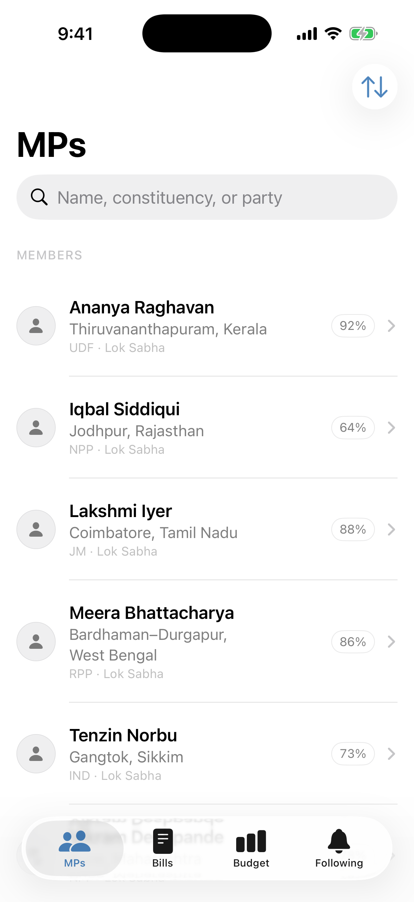<br><b>MPs</b></td>
    <td align="center">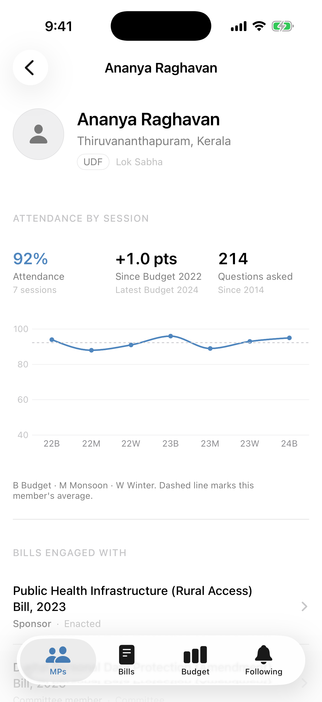<br><b>MP profile</b></td>
    <td align="center">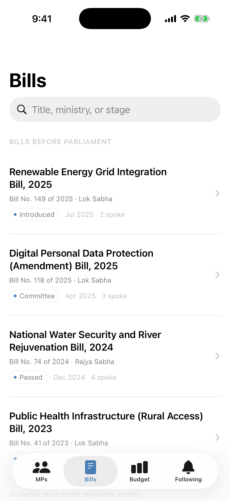<br><b>Bills</b></td>
    <td align="center">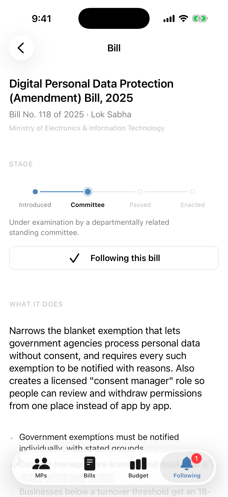<br><b>Bill detail</b></td>
  </tr>
  <tr>
    <td align="center">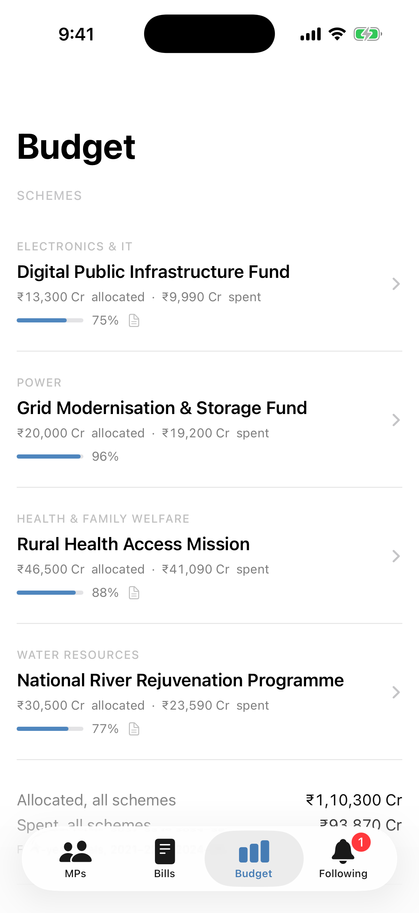<br><b>Budget</b></td>
    <td align="center">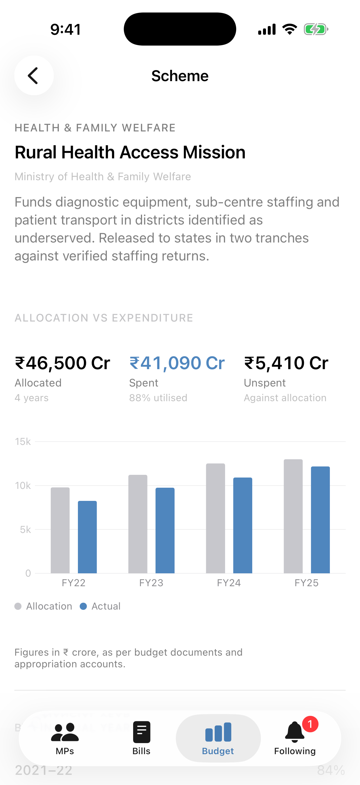<br><b>Scheme detail</b></td>
    <td align="center">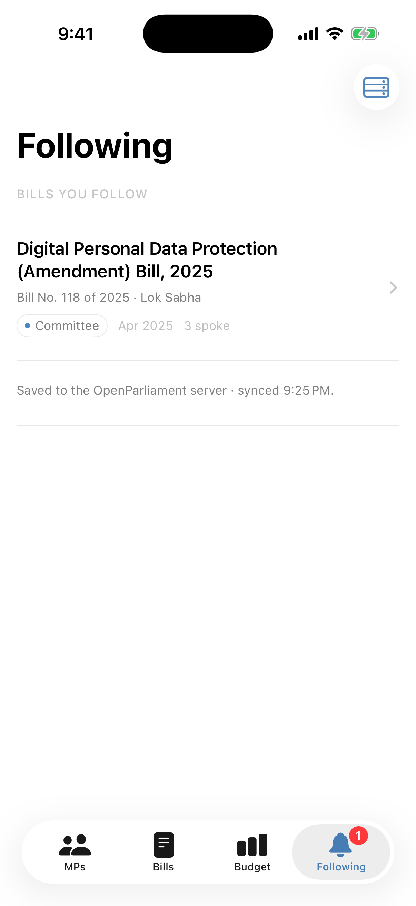<br><b>Following</b></td>
    <td align="center">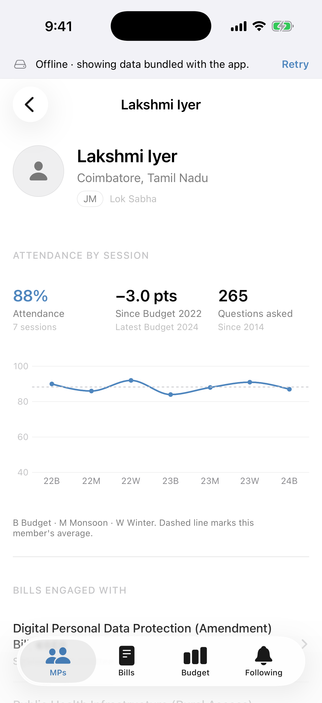<br><b>Offline mode</b></td>
  </tr>
</table>

More screens are in [`Docs/screenshots`](Docs/screenshots).

## Features

| Tab | What you can do |
| --- | --- |
| **MPs** | Search by name, constituency, state or party; sort by name, attendance or constituency. Profiles show attendance across seven sessions as a chart, the trend since the first session, questions asked, bills engaged with (sponsor, co-sponsor, committee member, debated), every speech on record and committee memberships. |
| **Bills** | Bills ordered by most recent activity, searchable by title, ministry, number or stage. Each bill has a four-stage progress stepper, a plain-language summary and key points, dated history, the members who spoke on it, and the budget schemes that fund it. |
| **Budget** | Schemes with their utilisation. Each scheme shows allocated, spent and unspent totals, an allocation-vs-expenditure bar chart for four financial years, a year-by-year table, any CAG audit observation and the bills that enable it. |
| **Following** | Bills you follow, saved to the database and kept in sync. Swipe to unfollow. A server sheet lets you change and test the API address. |

Everything links across tabs: bill → member, bill → scheme, scheme → bill.

**Resilience**

- Following a bill updates the UI immediately, then writes to the database. If the write fails, the change rolls back and a notice explains why.
- If the server can't be reached at launch, the app shows a clear error with **Try again** and **Use offline data**. Offline mode loads the same records bundled with the app and shows a banner with a Retry button.
- Pull to refresh on every list.

## Architecture

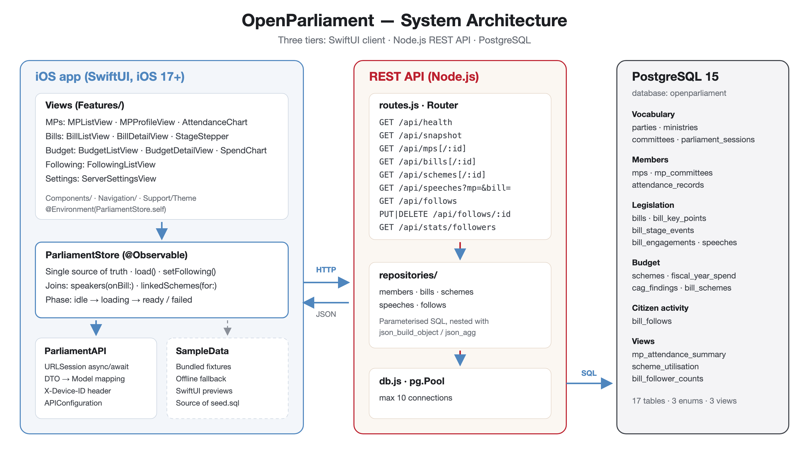

- **SwiftUI client** — views read from a single `@Observable` `ParliamentStore`, injected with `.environment`. The store calls `ParliamentAPI` (URLSession + async/await) and maps wire DTOs onto the app's models.
- **Node.js REST API** — a small `node:http` server with a hand-written router. Repositories build each record, with its child rows already nested, in one SQL statement using `json_build_object` and `json_agg`.
- **PostgreSQL** — the only component holding data. Schema in third normal form, with enum types, CHECK constraints and derived views.

### Data flow

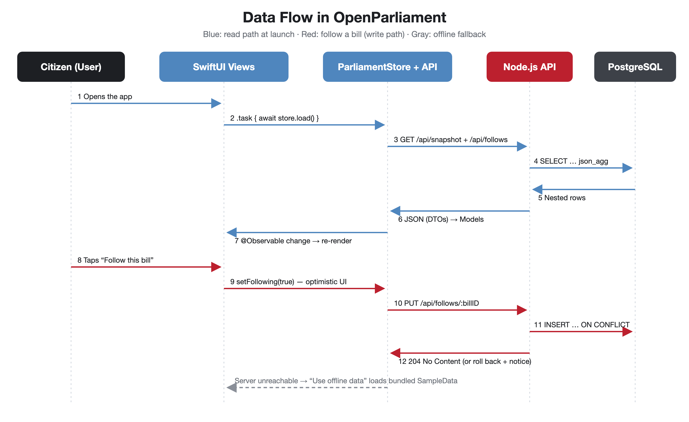

## Getting started

### Requirements

- macOS with **Xcode 26** (iOS 17+ SDK)
- **PostgreSQL 15** — `brew install postgresql@15`
- **Node.js 20+**

### 1. Database

```bash
brew services start postgresql@15
```

```bash
cd Server
npm install
npm run db:setup
```

`db:setup` creates the `openparliament` database (if needed), applies the schema and loads the seed data. Re-running it resets the database.

### 2. API server

```bash
cd Server
npm start
```

The API listens on `http://localhost:8080`. Check it with:

```bash
curl http://localhost:8080/api/health
```

### 3. App

Open `OpenParliament.xcodeproj` in Xcode and run the **OpenParliament** scheme on an iPhone simulator. The simulator reaches the server at `localhost`.

**On a physical iPhone**, open **Following → server icon**, enter your Mac's address on the same Wi-Fi network (for example `192.168.1.20:8080`), tap **Test connection**, then **Connect**.

### Configuration

| Setting | Where | Default |
| --- | --- | --- |
| Server port / host | `PORT`, `HOST` env vars | `8080`, `0.0.0.0` |
| Database | `PGDATABASE` (plus standard `PGHOST`, `PGUSER`, `PGPASSWORD`) | `openparliament` |
| App server URL | Settings sheet in the app, or `OPENPARLIAMENT_API_URL` launch env var | `http://localhost:8080` |

## REST API

| Method | Endpoint | Description |
| --- | --- | --- |
| GET | `/api/health` | Server and database status |
| GET | `/api/snapshot` | Members, bills, schemes and speeches in one response (used at launch) |
| GET | `/api/mps`, `/api/mps/:id` | Members with attendance history, committees and bill engagements |
| GET | `/api/bills`, `/api/bills/:id` | Bills with key points, stage history and linked schemes |
| GET | `/api/schemes`, `/api/schemes/:id` | Schemes with yearly spend and CAG finding |
| GET | `/api/speeches?mp=&bill=` | Speeches, optionally filtered by member and/or bill |
| GET | `/api/follows` | Bills followed by the calling device |
| PUT | `/api/follows/:billID` | Follow a bill (idempotent) → `204` |
| DELETE | `/api/follows/:billID` | Unfollow a bill → `204` |
| GET | `/api/stats/followers` | Follower count per bill |

Follow endpoints require an `X-Device-ID` header containing a UUID. The app generates one per install and stores no personal data.

## Database

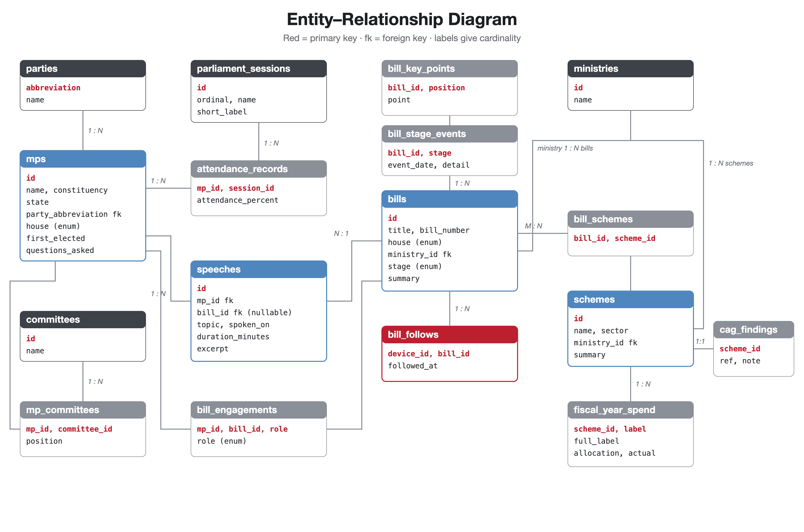

17 tables, 3 enum types (`house_name`, `bill_stage`, `engagement_role`) and 3 views:

| View | Computes |
| --- | --- |
| `mp_attendance_summary` | Mean attendance per member |
| `scheme_utilisation` | Total allocation, actual spend, unspent and utilisation % per scheme |
| `bill_follower_counts` | Followers per bill |

The schema lives in [`Server/db/schema.sql`](Server/db/schema.sql).

### Seed data

[`Server/db/seed.sql`](Server/db/seed.sql) is **generated** from the app's own fixtures (`OpenParliament/Data/Sample*.swift`), so the database and the app's offline data never drift apart. After editing the fixtures:

```bash
cd Server
./tools/generate-seed.sh
npm run db:setup
```

## Project structure

```
OpenParliament/
├── OpenParliament/                  iOS app
│   ├── App/                         OpenParliamentApp, RootTabView (loading / error / offline states)
│   ├── Models/                      MP, Bill, BudgetScheme, Speech, shared vocabulary
│   ├── Data/
│   │   ├── ParliamentStore.swift    @Observable store: loading, follows, joins, aggregates
│   │   ├── Remote/                  ParliamentAPI, DTOs, APIConfiguration, DeviceIdentity
│   │   └── Sample*.swift, Fixture   bundled dataset (offline, previews, seed source)
│   ├── Features/                    MPs/, Bills/, Budget/, Following/, Settings/
│   ├── Components/                  Chrome/ (badges, tiles, stepper, banners), Rows/
│   ├── Navigation/                  typed navigation destinations
│   └── Support/                     Theme tokens, formatting, button style
├── Server/
│   ├── db/                          schema.sql, seed.sql, setup.sh
│   ├── src/                         index.js, routes.js, http.js, db.js, config.js
│   │   └── repositories/            members, bills, schemes, speeches, follows
│   ├── test/api.test.js             end-to-end API tests
│   └── tools/                       seed generator
└── Docs/                            report, poster, screenshots, diagrams
```

## Testing

With the database seeded and the server running:

```bash
cd Server
npm test
```

The end-to-end suite checks the health endpoint, the nested snapshot, 404 handling, speech filtering, the follow/unfollow round trip through the database (including idempotency) and device-ID validation.

## Documentation

- [`Docs/OpenParliament Project Report.docx`](Docs/OpenParliament%20Project%20Report.docx) — full project report (K. J. Somaiya School of Engineering template) with design, implementation, screenshots and testing
- [`Docs/poster/OpenParliament Poster.pdf`](Docs/poster/OpenParliament%20Poster.pdf) — A-series poster of functions, screens and data flow. Its source is [`poster.html`](Docs/poster/poster.html); re-export with `Docs/poster/export.sh`
- [`Docs/diagrams`](Docs/diagrams) — architecture, data-flow and ER diagrams (SVG sources + PNG)

---

Built by **Soumil Sinha** for *iOS App Development with SwiftUI* (Semester VII), Department of Computer Engineering, K. J. Somaiya School of Engineering.
